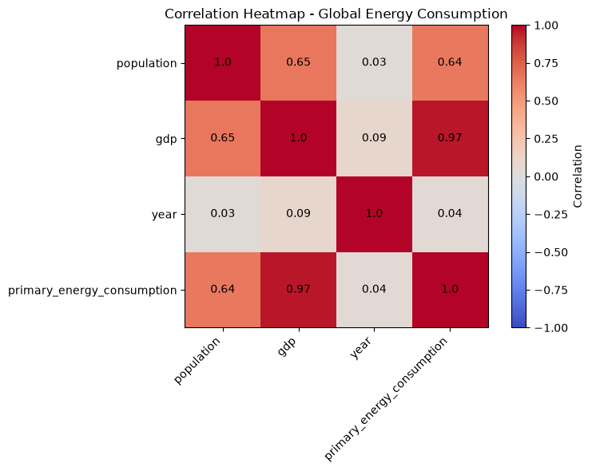
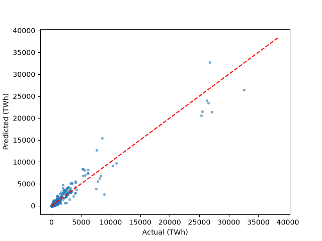

# Predicting Global Energy Consumption

Predicts a country's yearly primary energy consumption (TWh) from its population, GDP and year, using linear regression (pandas, matplotlib, seaborn, scikit-learn).

`AI101 Mini-Project` · `Group 73` · `Python 3.10+`

---

## Team and roles

| Member | Entry no. | Role |
|--------|-----------|------|
| Aadyant Chaturvedi | 2026EEB1311 | Documentation Lead |
| Ayush Yogesh Sakure | 2026AIB1026 | Execution Lead |
| Padakandla Rohith | 2026MCB1552 | Video Lead |
| Sahil Shekhawat | 2026EEB1405 | PPT Lead |

*All members contributed code (see commit history).*

---

## Project structure

```
Predicting-Global-Energy-Consumption/
├── Dataset/
│   └── dataset_Description.md
│   └── World_Energy_Consumption.csv
├── main.py
├── output/
│   └── Predicted_Values.csv
│   └── predicted_vs_actual.png
│   └── correlation_heatmap.png
│   └── test_Values.csv
├── requirements.txt
└── README.md
```

---

## Dataset

| Item | Details |
|------|---------|
| Source | https://www.kaggle.com/datasets/pralabhpoudel/world-energy-consumption |
| Licence / terms of use | Attribution 4.0 International |
| Rows × columns | 22,012 × 129 in the raw file; 4,732 rows used after cleaning |
| Time period covered | Raw file: 1900–2022. Used: 1990–2018 |
| Geographic coverage | Raw file: 306 entities, of which 219 are countries (have an ISO code) and 87 are regions, income groups or historical states (e.g. "World", "OECD (EI)"). Used: 165 countries |
| Consumption measured | Primary energy consumption, `primary_energy_consumption` |
| Target variable | `primary_energy_consumption`: a country's total primary energy use in a year. Modelled as its natural log |
| Features used | `log(population)`, `log(GDP)`, `year`|
| Preprocessing | Kept only rows with an ISO country code (regions and groups would double-count energy); kept 1990 onwards; dropped rows missing the target, population or GDP (2,311 rows); took natural logs|

---

## Method

| Item | Details |
|------|---------|
| Problem type | Regression (predict a continuous number) |
| Model(s) | Linear Regression|
| Train / test split | A random 80/20 split (seed 42) is run |
| Evaluation metric(s) | R² (on the log scale and in TWh), MAE, RMSE |
| Results | See table below |

**Results on the test years (2011–2018):**

| R² (TWh) | MAE (TWh) | RMSE (TWh) |
|0.93|248.9|683.1|

**Limitations:**
- Errors are largest for a few countries. The biggest misses are North Korea, because their data is largely misreported.
- A few very large countries dominate the RMSE.
- Countries with missing GDP or population are 'excluded, so results cover 165 of the 219 countries.

---
## Setup

Tested on Python 3.15/3.14.6 on Windows 11.

```bash
git clone https://github.com/Aadyant-Chaturvedi/Predicting-Global-Energy-Consumption/edit/main/README.md
cd Predicting-Global-Energy-Consumption
python -m venv venv
source venv/bin/activate      # Windows: venv\Scripts\activate
pip install -r requirements.txt
```

---

## How to run

1. Run python src/main.py from the project folder.
2. The script prints the MAE, RMSE, R2 and outputs the plot of predicted vs actual values
3. Expected runtime: under 10 seconds on the machine used for testing. [Mine -> 5.259s]

---

## Expected output
```bash
R2: 0.93
MAE: 248.9 TWh
RMSE: 683.1 TWh
```



It also outputs the predicted values and the y_test dataset so that they can be compared


---

## Links

- Slides 
- Video 
(to be updated)
---

## AI-use disclosure

(To be updated)
